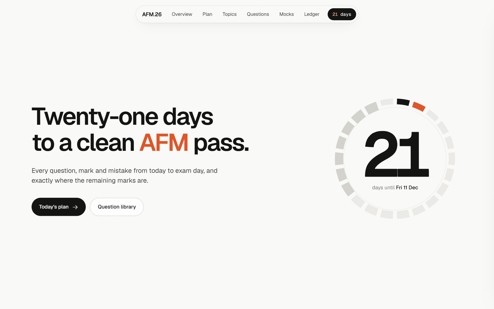
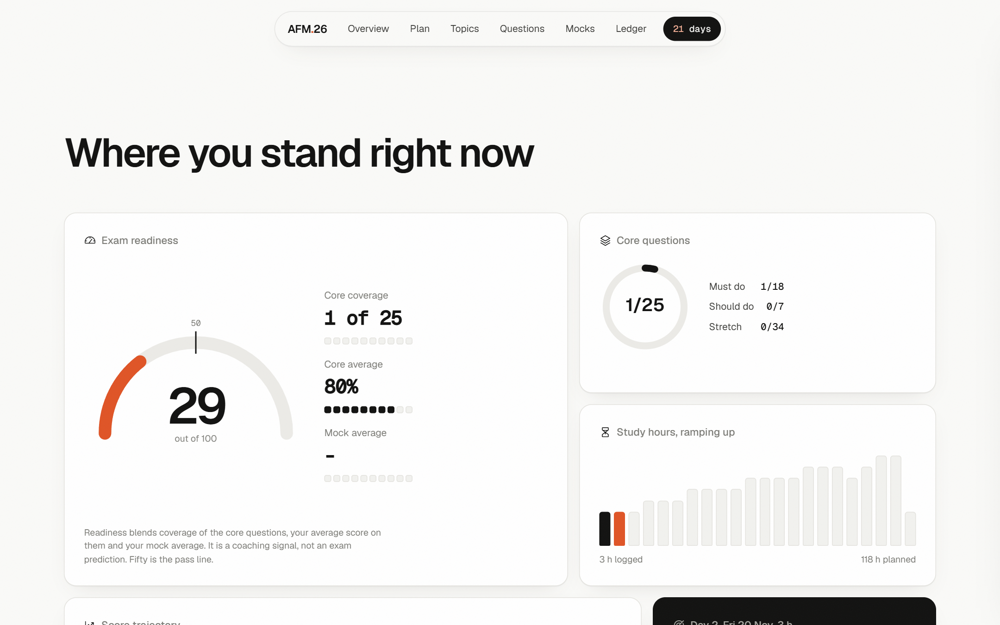
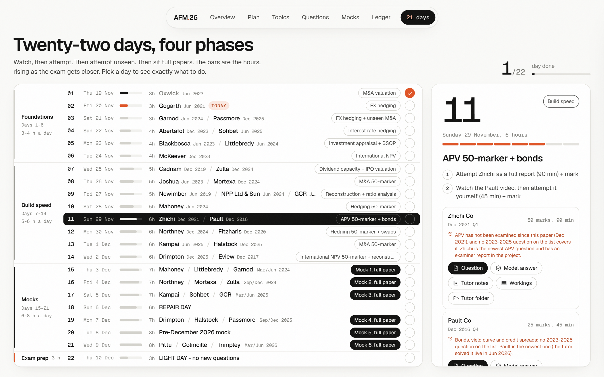
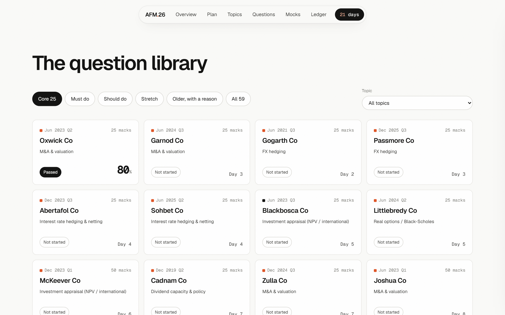

<div align="center">

# AFM Journey

**A single-page study dashboard for the ACCA Advanced Financial Management exam, 11 December 2026.**

The plan, every practice question, marks, mocks, professional-skills scores and every lost mark in one place, rebuilt from a single data file after each marking session.

[](https://github.com/ammar8bit/afm-journey/actions/workflows/deploy.yml)
[](LICENSE)


**[Open the live site](https://ammar8bit.github.io/afm-journey/)**



</div>

## What it shows

| | |
|---|---|
|  | **Where you stand.** A readiness gauge that blends core-question coverage, the average core score and the mock average, plus core progress by tier, the study-hours ramp and a score trajectory against the 50% pass line. |
|  | **The 22-day plan, on one screen.** Each day lists its questions with their exam sitting, the topic and the planned hours. Pick a day to see numbered steps, and open the question paper, ACCA answer, tutor notes or tutor workings in a new tab. Older questions say why they are in the plan. |
|  | **The question library.** All 59 questions from the tutor's top-51 list, filterable by tier and topic with animated re-layout. Each one opens a drawer with its links and every marked attempt. |

Further down the page: a topic radar (exam frequency against your average), the mock tracker against rising targets, the professional-skills grid, and a mistake ledger that turns every lost mark into a rule to remember.

## How it works

```
data/journey-data.js ──┐
src/index.template.html ┼──> scripts/build.py ──> dist/index.html  (one self-contained file)
vendor/ (GSAP, fonts, icons) ┘
```

- **One data file.** Everything the page shows lives in [`data/journey-data.js`](data/journey-data.js). The format is documented in [`docs/data-schema.md`](docs/data-schema.md).
- **One output file.** `build.py` inlines the data, GSAP, fonts and icons into `dist/index.html`. It works offline, by double-click, or from any static host.
- **No toolchain.** The build, dev server and checker use only the Python standard library. Nothing to install.
- **Checked on every push.** [`scripts/check_data.py`](scripts/check_data.py) validates the data (topics, dates, mark ranges, Drive URLs, a reason for any core question older than 2023). GitHub Actions then builds and deploys to Pages.

## Getting started

Requires Python 3.9+.

```bash
git clone https://github.com/ammar8bit/afm-journey.git
cd afm-journey
python scripts/serve.py --open      # http://localhost:8765, rebuilds on every refresh
```

On Windows you can double-click **`Open AFM Journey.bat`** instead.

| Task | Command |
|---|---|
| Validate the data | `python scripts/check_data.py` |
| Build `dist/index.html` | `python scripts/build.py` |
| Run the dev server | `python scripts/serve.py --open` |
| Check, build, commit and push (Windows) | `.\scripts\publish.ps1 "Mark Garnod 18/25"` |
| Refresh README screenshots (Node 22+, Edge or Chrome) | `node scripts/screenshots.mjs` |

## Updating after a marking session

1. Edit `data/journey-data.js`: push an attempt onto the question, set mock scores, add skills placements and mistakes (see [`docs/data-schema.md`](docs/data-schema.md)).
2. Run `python scripts/check_data.py`.
3. Commit and push. The [Deploy workflow](.github/workflows/deploy.yml) validates, builds and publishes the page.

## Project structure

```
.
├── .github/workflows/deploy.yml   CI: validate, build, deploy to GitHub Pages
├── data/journey-data.js           all content: plan, questions, mocks, skills, mistakes
├── docs/
│   ├── data-schema.md             data format reference
│   └── screenshots/               README images
├── scripts/
│   ├── build.py                   template + data + vendor -> dist/index.html
│   ├── check_data.py              data validation (used by CI)
│   ├── serve.py                   local dev server on :8765
│   ├── publish.ps1                check, build, commit, push
│   └── screenshots.mjs            headless README screenshots
├── src/index.template.html        markup, styles and behaviour
├── vendor/                        GSAP 3.12.5, Geist fonts, Phosphor icons
└── Open AFM Journey.bat           Windows launcher
```

## Design

Off-white `#fafaf8` on near-black `#111110`, with a single vermilion accent `#df5426`. Type is Geist and Geist Mono. Motion uses GSAP ScrollTrigger and Flip, and switches off when the system asks for reduced motion. Charts are hand-built SVG. The layout works down to phone width.

## Credits and licence

The code is under the [MIT License](LICENSE). Vendored GSAP, Geist and Phosphor keep their own licences; see [`THIRD_PARTY_NOTICES.md`](THIRD_PARTY_NOTICES.md). Exam papers, ACCA answers and tutor notes are not in this repository. The site only links to them in their owners' Google Drive.
